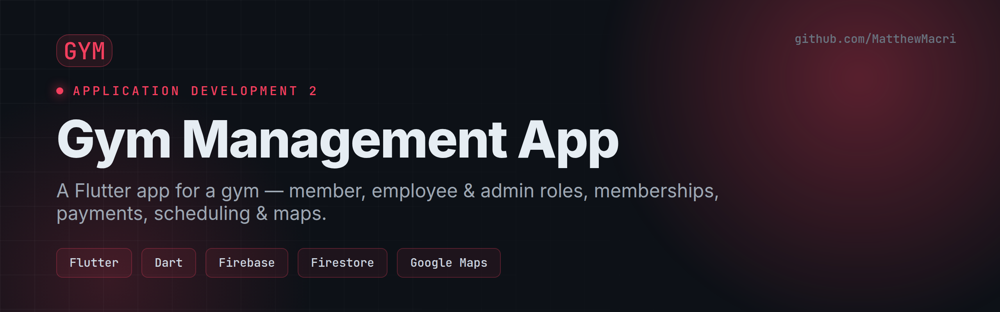

# Gym Management App

> A cross-platform Flutter application for running a gym — separate portals for members, employees, and admins, with memberships, payments, scheduling, maps, and notifications.


Team project for **Application Development 2** at Vanier College.

---

## Overview

A full gym-management app built with Flutter and Firebase. It supports three kinds of users — **members**, **employees**, and **administrators** — each with their own login and screens. Members manage their accounts and memberships; employees and admins handle enrollment, scheduling, payments, and moderation. Data is stored in **Cloud Firestore** with **Firebase Authentication** for sign-in.

## Preview

<p align="center">
  
</p>

## Features

- 👥 **Role-based logins** — member, employee, and admin portals
- 🪪 **Membership management** — create, renew, alter, cancel, and verify memberships
- 💳 **Account payments** and renewals
- 🗓️ **Scheduling** — assign and view employee schedules
- 🚫 **Moderation** — ban / unban member accounts
- 🗺️ **Location map** via Google Maps + geolocation
- 🔔 **Notifications** with `awesome_notifications`
- ☁️ **Firebase** auth + Cloud Firestore backend

## Tech Stack

| Area | Tools |
|------|-------|
| Framework | Flutter (Dart) |
| Auth & DB | Firebase Auth, Cloud Firestore |
| Maps | google_maps_flutter, geolocator, flutter_polyline_points |
| Notifications | awesome_notifications |
| Targets | Android, iOS, Web |

## Getting Started

```bash
git clone https://github.com/MatthewMacri/AppDevProject.git
cd AppDevProject/appdev2project

flutter pub get

# Add your own Firebase config (google-services.json / firebase_options.dart),
# then run on a device or emulator:
flutter run
```

> Requires the [Flutter SDK](https://docs.flutter.dev/get-started/install) and a Firebase project. Google Maps features need a Maps API key.

## Project Structure

```
appdev2project/
├── lib/            # Dart source — login flows, member/employee/admin screens
├── android/        # Android platform project
├── ios/            # iOS platform project
├── web/            # Web build target
└── pubspec.yaml    # Dependencies
```

## Author

**Matthew Macri** (team project) — [LinkedIn](https://www.linkedin.com/in/m-macri/) · [GitHub](https://github.com/MatthewMacri)
